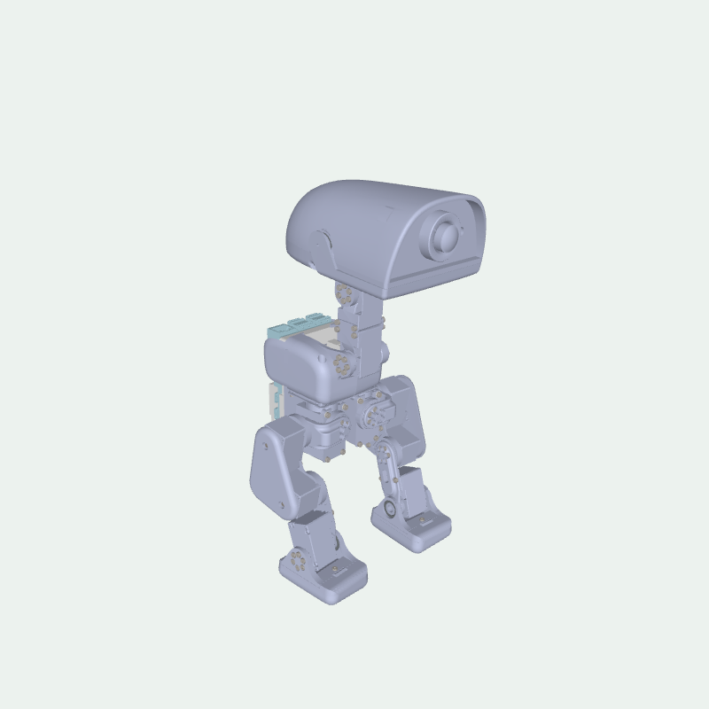

# S288 Calibration Studio

Windows桌面上的S288舵机调试与软件零位标定工具。提供模拟体验、角度滑块、零位记录与回零、机械结构模型绑定和部署标定导出。

`v0.1.2`采用部署标定例程的输出编码器零位，回零使用S形加减速，让目标起停更平缓。

A Windows desktop tool for S288 servo adjustment, software-zero calibration and a 15-joint mechanical preview.

本项目为社区工具，提供Windows启动方式。软件代码采用MIT许可证，机械素材的许可范围见[模型说明](assets/README.md)。



*图片仅展示结构外形，不作为零位参考。公开版保留原机械结构的外形、转轴与关节随动，移除了本地CAD路径；没有附带真实舵机ID绑定、零位或动力学参数。*

## 功能

- 同一串口下选择ID 0–14，逐个调节目标角度、控制方向和限位；Kp/Kd统一应用到全部ID。
- 单台或一键记录全部已连接舵机的软件零位并保存JSON，支持清除单个或全部零位。
- 按保存的零位平滑回零，起停逐渐加减速，短行程自动降低峰值速度；以实际偏差不超过5°且运动稳定作为到位条件。
- 机械结构默认按实际反馈联动，已标定关节在项目零位支架设计参考姿态上叠加ExPos相对角度；支持目标预览、视角、半透明及深浅色主题。
- 调节、设置、反馈和日志同时显示；反馈和状态变化不会挤动模块尺寸，窗口仍可手动缩放。
- 导入训练关节布局，导出独立的部署标定文件。

## 普通用户下载

在GitHub的**Releases**中下载名称带`Windows_x64.zip`的软件包，完整解压后双击`S288Studio.exe`即可使用，无需安装Python或Conda。保留EXE旁的所有文件；首次体验在界面勾选“模拟设备”，填写ID后连接。

GitHub自动生成的“Source code”及本仓库源码供开发者使用，运行步骤见下一节。便携包说明见[Windows解压即用版](docs/PORTABLE.md)。

## 源码安装与启动

需要Windows 10/11、Python 3.10或以上（64位，安装时启用Tk）。在解压后的项目目录打开PowerShell：

```powershell
py -3 -m venv .venv
.\.venv\Scripts\python.exe -m pip install -r requirements.txt
```

双击 **模拟体验.bat**，先在不连接硬件的情况下练习。实机界面使用 **启动工具.bat**，进入后由使用者选择串口和ID，再连接。

启动器依次使用：

1. 环境变量`S288_PYTHON`指定的完整`python.exe`路径；显式指定错误时直接报告。
2. 项目内`.venv\Scripts\python.exe`。
3. Windows Python启动器`py -3`。
4. 系统`python.exe`。

也可以使用已经激活的环境直接运行：

```powershell
python app.py --demo
python app.py
```

源码目录需要可写，运行后会在`configs/`保存本机文件。使用串口时安装对应适配器驱动，并关闭占用同一串口的其他工具。

## 第一次体验

1. 打开模拟体验，等待“模拟设备已连接”。
2. 选中一个ID，点“使能 · 保持当前位置”。
3. 给限位内的小角度，观察实际反馈和模型；点“释放当前舵机”结束。
4. 在主界面右上角点“使用指引”，按“记录并保存零位”“绑定机械关节”“回到保存零位”继续练习。

模拟设备只用于软件体验。操作实机时支撑好机构，核对接线、ID、运动空间和机械限位；释放请求不能代替断电。

## 配置与模型

源码与通用发布包只含`configs/examples/`中的空白示例。实机与模拟配置分别保存，个人零位、绑定和日志由`.gitignore`排除。保留本机参数的个人升级包不用于公开分发。

控制方向决定真实舵机转向，模型方向决定显示转向。界面目标使用度，内部控制与保存的零位使用弧度。

显示模型采用项目零位支架设计的参考姿态，通过静态显示姿态偏移区别于原CAD保存的装配姿态；软件0°对应支架设计零位，界面角度显示相对支架的变化。原CAD、模型网格和舵机参数保持原值。“视角复位”只调整相机。临时对齐仍只影响本连接显示，可恢复软件零位显示。

支架设计依据14个训练关节的q=0，并非站立HOME；嘴部第15关节保留原CAD嘴部参考姿态，闭合位置须独立核对。设计参考核对不等于实物姿态或嘴部闭合已验收。

软件零位使用保存的ExPos单圈参考，已有记录无需仅因升级重标。“回零／限速”仍为目标速度上限；平滑回零的5°到位容差只用于验收，不会消除机械偏差或自动补偿末端。详细的角度换算、临时模型参考与故障诊断见[完整操作说明](docs/USAGE.md)。

连接不会自动运动或把当前姿态设为0°。输出编码器是单圈参考，拆装、更换舵机后仍须核对机械基准；通信或状态异常时停止控制并检查后重连。当前未完成整机真机验收，也不支持舵机在控制中断电后自动继续旧目标。

部署标定的14关节模式使用参考例程固定布局；自定义15关节导出需要部署程序和策略配套适配。标定用Kp/Kd不能自动作为训练或部署增益。

## 测试与开发

```powershell
python -B tests/run_checks.py
```

测试使用模拟设备、串口替身和临时文件，完整检查需要Windows、Tk和可用的OpenGL环境。本仓库未配置自动CI工作流，请在本地运行上述命令并检查模拟界面。

当前公开版已在Windows上完成离线及模拟界面检查。它没有进行整机实机验收，不提供ONNX权重或自动行走部署。

## 文档

- [完整操作与代码结构](docs/USAGE.md)
- [空白配置说明](configs/examples/README.md)
- [参与修改](CONTRIBUTING.md)
- [来源与第三方依赖](THIRD_PARTY_NOTICES.md)

## 许可证

软件代码使用[MIT许可证](LICENSE)。机械素材的许可单独说明，见[模型来源](assets/README.md)；第三方依赖保留其各自许可。
